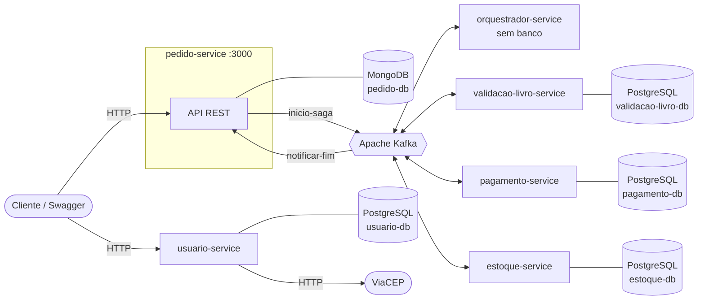
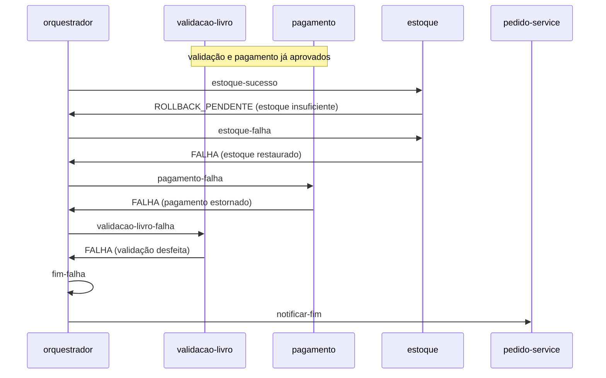
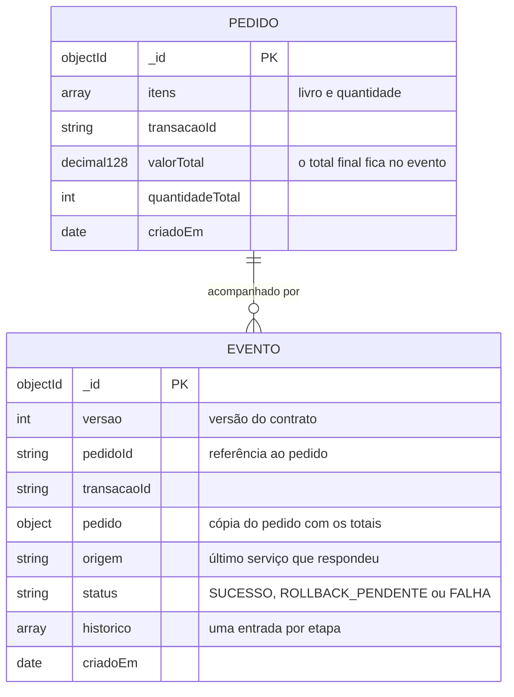
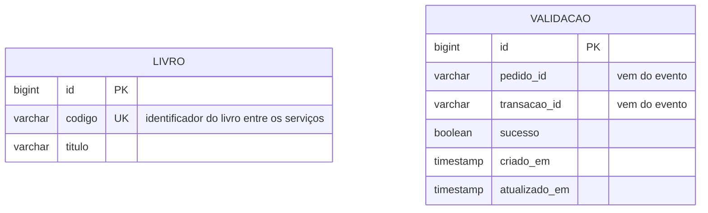
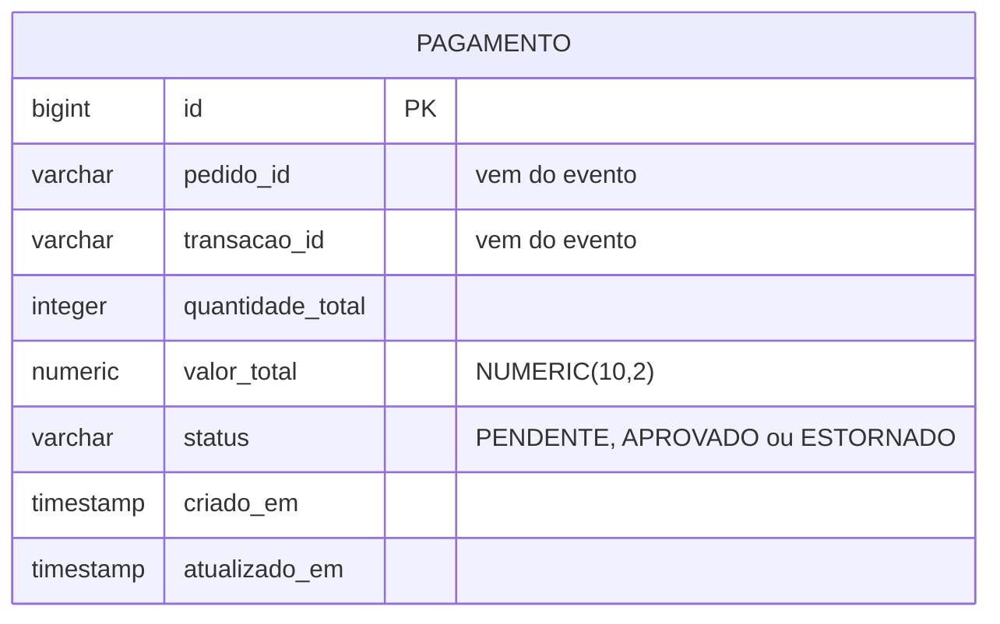
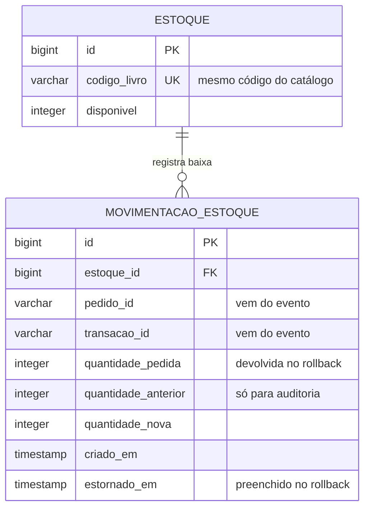
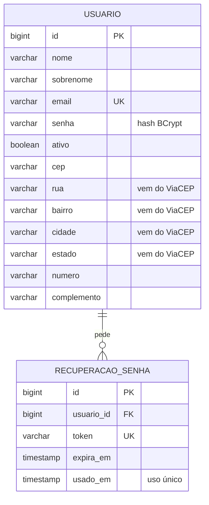

# Saga orquestrada com microsserviços

Projeto de estudo do padrão Saga orquestrado. O domínio é uma livraria: um pedido passa pela validação dos livros, pelo pagamento e pela baixa de estoque, cada etapa num serviço com seu próprio banco. Como não dá pra ter uma transação única entre bancos diferentes, um orquestrador coordena as etapas pelo Kafka e, se alguma falhar, manda desfazer as que já tinham rodado.

## Tecnologias

Java 21, Spring Boot 3.5, Apache Kafka, PostgreSQL 16 com Flyway, MongoDB 7 e Docker. O login usa JWT (jjwt) gravado em cookie e senha com BCrypt. O Redpanda Console sobe junto para ver as mensagens no Kafka. Os testes usam JUnit 5, Mockito e AssertJ.

## Como rodar

Precisa de Java 21 e Docker. Não precisa instalar Maven, cada serviço tem o wrapper (`mvnw`).

O jeito mais simples é o script da raiz, que precisa de Python 3 (no Windows o comando é `py`):

```bash
py build.py
```

Ele roda `docker compose up --build -d` e espera cada serviço iniciar. Os containers que já estão no ar e não mudaram continuam rodando; só o serviço cujo código mudou é reconstruído e reiniciado, então a partir da segunda vez sobe bem mais rápido. Também dá pra rodar `py build.py --testes` para rodar os testes antes de subir, `py build.py --recriar` para derrubar tudo e subir do zero, e `py build.py --parar` para derrubar tudo.

Sem o script:

```bash
docker compose up --build -d
```

A primeira vez demora alguns minutos porque o build das aplicações roda dentro das imagens.

Para desenvolver, prefiro subir só os bancos e o Kafka no Docker e rodar os serviços pela IDE:

```bash
docker compose up -d pedido-db validacao-livro-db pagamento-db estoque-db usuario-db kafka redpanda-console
```

Depois é rodar a classe `*Application` de cada serviço, ou `./mvnw spring-boot:run` dentro da pasta dele. O pagamento e o estoque precisam da variável `DB_PORT` (5433 e 5434), porque cada Postgres do compose está numa porta diferente. O usuario-service já vem com a porta 5435 como padrão.

Se os containers dos serviços estiverem rodando, não suba os mesmos serviços pelo `mvnw`, as portas já vão estar ocupadas.

### Vendo a saga funcionar

Com tudo no ar, o `demo.py` faz pedidos de exemplo e mostra cada etapa por onde o pedido passou, com o tempo de cada uma e o link do documento no MongoDB:

```bash
py demo.py
```

Ele roda cinco cenários: compra aprovada, falha no estoque, falha no pagamento, livro fora do catálogo e uma mensagem com JSON quebrado indo para a DLT. Dá pra rodar só um, por exemplo `py demo.py estoque`. Cada compra aprovada baixa o estoque de verdade, então depois de muitas execuções o livro acaba. Para voltar ao estoque inicial, rode `py build.py --recriar`, que derruba os containers e sobe os bancos do zero.

```
=== Falha no estoque ===
  3 x O Cortiço, que só tem 2. Validação e pagamento passam, o estoque recusa e tudo é desfeito.
    +0.00s  Orquestrador         ok        Saga iniciada.
    +0.04s  Validação de livros  ok        Livros validados com sucesso.
    +0.09s  Pagamento            ok        Pagamento realizado com sucesso.
    +0.17s  Estoque              falhou    Falha ao atualizar o estoque: Estoque insuficiente para o livro.
    +0.24s  Estoque              desfeito  Rollback executado no estoque.
    +0.32s  Pagamento            desfeito  Estorno do pagamento realizado.
    +0.60s  Validação de livros  desfeito  Rollback executado na validação dos livros.
    +0.64s  Orquestrador         desfeito  Saga finalizada com erros.
```

### Testando o fluxo na mão

O mais fácil é pelo Swagger: http://localhost:3000/swagger-ui.html

Ou pelo curl:

```bash
curl -X POST http://localhost:3000/api/pedidos \
  -H "Content-Type: application/json" \
  -d '{"itens":[{"livro":{"codigo":"DOM_CASMURRO","valorUnitario":39.90},"quantidade":2}]}'
```

Com o `id` que volta na resposta dá pra acompanhar a saga:

```bash
curl "http://localhost:3000/api/eventos?pedidoId=<id do pedido>"
```

Para ver um rollback acontecer, peça 3 unidades de `O_CORTICO`, que só tem 2 em estoque.

Os livros que as migrations já cadastram são `DOM_CASMURRO` (4 em estoque), `O_CORTICO` (2), `IRACEMA` (5) e `MEMORIAS_POSTUMAS` (9).

As mensagens trocadas no Kafka aparecem no Redpanda Console, em http://localhost:8081.

### Portas

| Serviço | Porta |
|---|---|
| pedido-service | 3000 |
| orquestrador-service | 8080 |
| validacao-livro-service | 8090 |
| pagamento-service | 8091 |
| estoque-service | 8092 |
| usuario-service | 8093 |
| Redpanda Console | 8081 |
| mongo-express (tela do MongoDB) | 8082 |
| Kafka | 9092 |
| MongoDB | 27017 |
| PostgreSQL (validação, pagamento, estoque, usuário) | 5432, 5433, 5434, 5435 |

Usuário e senha dos bancos estão no `docker-compose.yml`. São só de desenvolvimento.

## Arquitetura



Na saga, quem recebe o pedido é o pedido-service. Ele grava o pedido no MongoDB e publica o evento em `inicio-saga`. Daí pra frente tudo acontece pelo Kafka, e o resultado final volta pra ele no tópico `notificar-fim`.

O orquestrador é o único que conhece a ordem das etapas. Os outros serviços só sabem fazer e desfazer a própria parte: cada um escuta um tópico para executar (`*-sucesso`) e outro para desfazer (`*-falha`), e sempre responde no tópico `orquestrador`. Se eu quiser mudar a ordem das etapas, mexo só no orquestrador.

Cada serviço tem o próprio banco e nenhum acessa o banco do outro. Tudo o que um serviço precisa saber do pedido vem dentro do evento.

O usuario-service fica fora da saga. Ele cuida do cadastro, do login e da recuperação de senha, e consulta o ViaCEP para preencher o endereço no cadastro. No login ele grava o JWT num cookie, e a ideia é que os outros serviços validem esse token por conta própria, sem chamar o usuario-service.

## Síncrono e assíncrono

A regra que segui: **o usuário fala com os serviços de forma síncrona (HTTP), e os serviços falam entre si de forma assíncrona (Kafka)**. A única chamada síncrona entre sistemas é a consulta de CEP no ViaCEP.

| Ação do usuário | Serviço | Como | O que volta na hora |
|---|---|---|---|
| Criar pedido | pedido-service | HTTP para registrar, Kafka para processar | `201` com o `id` do pedido, sem o resultado |
| Consultar o pedido | pedido-service | HTTP | Status e histórico de cada etapa |
| Cadastrar livro no catálogo | validacao-livro-service | HTTP, e o estoque é avisado pelo Kafka (`livro-cadastrado`) | O livro cadastrado |
| Registrar entrada de estoque | estoque-service | HTTP | O estoque atualizado |
| Consultar CEP, cadastrar-se, login e logout | usuario-service *(em construção)* | HTTP, e o CEP é consultado no ViaCEP também por HTTP | Endereço, usuário ou cookie de sessão |
| Cadastrar e listar cartões | pagamento-service *(planejado)* | HTTP | O cartão mascarado |

**Por que a saga é assíncrona.** Se o pedido-service chamasse validação, pagamento e estoque por HTTP, o usuário esperaria os três e qualquer um fora do ar derrubaria a compra. Pelo Kafka, se o estoque cair, a mensagem espera na fila e é processada quando ele voltar. O custo é que o resultado não volta na resposta do `POST`: o cliente consulta depois no `GET /api/eventos`.

**Login sem chamada a cada requisição** *(em construção)*. O usuario-service gera o JWT e o grava num cookie `HttpOnly` com `SameSite=Strict`. O navegador envia o cookie sozinho, e cada serviço confere a assinatura do token com o mesmo segredo, sem perguntar nada ao usuario-service. Se ele cair, quem já está logado continua comprando, só o login para. A contrapartida é que o logout só invalida o token no próprio usuario-service; nos outros ele vale até expirar, que hoje é 1 hora.

**Cartão em dois momentos** *(planejado)*. O cadastro é síncrono: o pagamento-service valida, criptografa e responde na hora. O uso é assíncrono: o pedido leva só o `cartaoId`, o `usuarioId` vem do token, e é na etapa de pagamento da saga que o pagamento-service confere se o cartão existe, é daquele usuário e não está vencido. Se não estiver, responde `ROLLBACK_PENDENTE` e a saga se desfaz como em qualquer outra falha. Não validei o cartão no momento do pedido porque isso obrigaria o pedido-service a chamar o pagamento por HTTP, e com o pagamento fora do ar ninguém conseguiria nem registrar o pedido. O número do cartão nunca passa pelo Kafka.

## Como a saga funciona

No caminho feliz a ordem é validação, pagamento e estoque. O `POST` responde antes da saga terminar, então o pedido existe por alguns instantes sem ter sido pago. O resultado aparece depois no `GET /api/eventos`.

Cada serviço responde com um status, e o orquestrador decide o próximo passo a partir dele:

- `SUCESSO`: a etapa terminou, segue para a próxima.
- `ROLLBACK_PENDENTE`: a etapa falhou. O orquestrador manda o mesmo serviço desfazer o que fez.
- `FALHA`: a etapa foi desfeita. O orquestrador volta para a etapa anterior, até chegar ao início.

Exemplo de um pedido com 3 unidades de `O_CORTICO`, que só tem 2 em estoque:



Cada passo fica registrado no `historico` do evento, então dá pra ver no `GET /api/eventos` onde a saga parou e por quê.

As regras de para onde ir ficam no enum `TransicaoSaga`, no orquestrador:

| Origem | Status | Próximo tópico |
|---|---|---|
| ORQUESTRADOR | SUCESSO | validacao-livro-sucesso |
| ORQUESTRADOR | FALHA | fim-falha |
| VALIDACAO_LIVRO_SERVICE | SUCESSO | pagamento-sucesso |
| VALIDACAO_LIVRO_SERVICE | ROLLBACK_PENDENTE | validacao-livro-falha |
| VALIDACAO_LIVRO_SERVICE | FALHA | fim-falha |
| PAGAMENTO_SERVICE | SUCESSO | estoque-sucesso |
| PAGAMENTO_SERVICE | ROLLBACK_PENDENTE | pagamento-falha |
| PAGAMENTO_SERVICE | FALHA | validacao-livro-falha |
| ESTOQUE_SERVICE | SUCESSO | fim-sucesso |
| ESTOQUE_SERVICE | ROLLBACK_PENDENTE | estoque-falha |
| ESTOQUE_SERVICE | FALHA | pagamento-falha |

No projeto original isso era uma matriz `Object[][]` lida por índice e com cast. Troquei por enum para o compilador conferir os tipos.

## Por que MongoDB no pedido

O pedido-service guarda o evento da saga: o pedido, os itens, o status e o histórico de cada etapa. Esse dado sempre é gravado e lido inteiro, e a consulta é só por `pedidoId` ou `transacaoId`. Num banco relacional isso viraria quatro tabelas e um join só para remontar um JSON que já chega pronto do Kafka. No Mongo eu gravo o documento do jeito que ele chega, e um campo novo no evento não precisa de migration.

Nos outros três serviços usei PostgreSQL porque o dado tem regra: código de livro único, estoque ligado às movimentações por chave estrangeira, pagamento com status. São estruturas fixas, e o banco relacional garante a integridade sozinho.

## Modelo de dados

Cada serviço tem o próprio banco, então não existe chave estrangeira entre serviços. O que liga os dados de um serviço aos de outro é o `pedido_id` e o `transacao_id` que chegam no evento, e o código do livro, que é o mesmo no catálogo e no estoque.

### pedido-db (MongoDB)



### validacao-livro-db (PostgreSQL)



### pagamento-db (PostgreSQL)



### estoque-db (PostgreSQL)



### usuario-db (PostgreSQL)



```
Estoque (1) ──── (N) MovimentacaoEstoque
Pedido  (1) ──── (N) Evento                 referência pelo pedidoId, sem chave estrangeira
Usuario (1) ──── (N) RecuperacaoSenha
```

## Decisões que tomei

Dinheiro em `BigDecimal`. Com `double`, um pedido de 3 livros de R$ 29,90 dava `89.69999999999999`. No Postgres a coluna é `NUMERIC(10,2)` e no Mongo o valor é gravado como `Decimal128`.

O contrato do evento (`Evento`, `Pedido`, `ItemPedido`, `Livro`, `Historico`) fica copiado no pacote `saga/` de cada serviço. Não fiz uma biblioteca compartilhada para não amarrar o deploy de todos os serviços. Para um campo novo não se perder quando passa por um serviço que ainda não o conhece, o `Evento` e o `Pedido` guardam os campos desconhecidos e devolvem do jeito que receberam.

O evento tem versão (`"versao": 1`) e cada serviço recusa a versão que não conhece. A regra que segui: acrescentar campo não muda a versão; renomear, remover ou mudar o tipo de um campo cria uma versão nova. Cada serviço tem uma cópia do exemplo do evento em `src/test/resources/contrato/evento-v1.json`, e o `ContratoDoEventoTest` garante que o serviço lê esse JSON e o devolve sem perder nada.

Falha de negócio e falha técnica seguem caminhos diferentes. Estoque insuficiente ou valor abaixo do mínimo viram `ROLLBACK_PENDENTE` e a saga se desfaz. Já uma mensagem que o serviço não consegue processar (JSON quebrado, versão desconhecida, banco fora do ar) é tentada de novo duas vezes e, se continuar falhando, vai para um tópico `.DLT`, por exemplo `estoque-sucesso.DLT`. JSON quebrado e versão desconhecida vão direto, porque tentar de novo não resolve.

Como o Kafka pode entregar a mesma mensagem mais de uma vez, cada serviço confere se já processou aquele `pedidoId` + `transacaoId` antes de executar a etapa. Assim não cobra nem baixa estoque duas vezes.

As regras ficam nas entidades: `Pagamento.aprovar()` recusa valor abaixo do mínimo, `Estoque.baixar()` recusa quantidade maior que a disponível e um `Pedido` não é criado sem itens. Cada regra tem a sua exceção com código e mensagem. No pedido-service ela vira resposta HTTP, e nos outros serviços a mensagem vai para o histórico da saga.

As datas vêm de um `Clock` injetado, o que deixa os testes previsíveis.

No usuario-service, as respostas não revelam se um e-mail tem conta, com uma exceção consciente. O login responde "E-mail ou senha incorretos" tanto para e-mail inexistente quanto para senha errada, o bloqueio depois de 5 tentativas conta também os e-mails que não existem, e o "esqueci a senha" sempre responde `204`. O cadastro é a exceção: ele responde `EMAIL_CADASTRADO` quando o e-mail já existe. Cheguei nisso revisando as mensagens de erro: essa resposta permite que um robô teste uma lista de e-mails e descubra quais têm conta (enumeração de usuários). Mantive a mensagem porque esconder a informação no cadastro só funciona confirmando a conta por e-mail, e o projeto ainda não envia e-mails; sem isso, quem já tem conta tentaria se cadastrar de novo e não entenderia o que aconteceu. O próximo passo é limitar as tentativas de cadastro por IP, no mesmo formato do bloqueio do login, para que o robô não consiga testar milhares de e-mails.

Enquanto digitava o `ControleDeTentativas`, percebi um caso que a regra de bloqueio do login não cobre. Depois de 5 senhas erradas o e-mail fica bloqueado por 60 segundos, mas quando o bloqueio vence a contagem recomeça do zero. Um robô paciente consegue 5 tentativas por minuto, sem fim: 7.200 por dia para cada e-mail. Também não resolvi trocando por um bloqueio longo, de um dia por exemplo, porque aí qualquer pessoa conseguiria travar a conta de outra só errando a senha de propósito. A saída que escolhi é o bloqueio progressivo: a espera dobra a cada novo bloqueio (1, 2, 4, 8 minutos...) até um teto de 24 horas, e um login certo zera tudo. Quem erra a senha algumas vezes quase não percebe, e o robô, ao chegar no teto, fica com 5 tentativas por dia em vez de 7.200. Para isso o `ControleDeTentativas` passou a guardar também quantas vezes o e-mail já foi bloqueado. Ainda falta o limite por IP, que fecha o ataque de testar a mesma senha em muitos e-mails diferentes.

## Estrutura

Cada serviço é organizado por domínio, no mesmo padrão do `card-service`. Exemplo do pagamento:

```
pagamento-service/src/main/java/com/livraria/pagamento/
├── pagamento/    entidade, service, consumer, repository e exceptions
├── saga/         contrato do evento, conversão de JSON e producer
└── shared/       configurações e tratamento de erros
```

O usuario-service segue o mesmo padrão, com os pacotes trazidos do card-service:

```
usuario-service/src/main/java/com/livraria/usuario/
├── usuario/            cadastro, login, recuperação de senha e bloqueio de tentativas
├── endereco/           consulta de endereço pelo CEP
├── integracao/viacep/  cliente HTTP do ViaCEP e os erros de comunicação
├── seguranca/          JWT, cookie de sessão, filtro de autenticação e logout
└── shared/             configurações e tratamento de erros
```

As migrations ficam em `src/main/resources/db/migration` de cada serviço com banco relacional. O `ddl-auto` está em `validate`, então quem cria e altera tabela é só o Flyway.

## Endpoints

Cada serviço tem o próprio Swagger em `http://localhost:<porta>/swagger-ui.html`.

### pedido-service (3000)

| Método | Endpoint | O que faz |
|---|---|---|
| POST | `/api/pedidos` | Cria o pedido e inicia a saga |
| GET | `/api/eventos?pedidoId=` | Último evento do pedido |
| GET | `/api/eventos?transacaoId=` | Último evento da transação |
| GET | `/api/eventos/todos` | Todos os eventos, do mais recente para o mais antigo |

Corpo do `POST /api/pedidos`:

```json
{
  "itens": [
    { "livro": { "codigo": "DOM_CASMURRO", "valorUnitario": 39.90 }, "quantidade": 2 },
    { "livro": { "codigo": "IRACEMA", "valorUnitario": 25.00 }, "quantidade": 1 }
  ]
}
```

O `valorTotal` vem zerado na resposta do `POST`. Quem calcula é o pagamento, e o valor aparece no evento final.

### usuario-service (8093)

| Método | Endpoint | Login? | O que faz |
|---|---|---|---|
| POST | `/api/usuarios` | não | Cadastra o usuário e preenche o endereço pelo CEP |
| POST | `/api/usuarios/login` | não | Confere a senha e grava o JWT no cookie `livraria_sessao` |
| POST | `/api/usuarios/esqueci-senha` | não | Gera um token de recuperação; por enquanto ele sai no log, não por e-mail |
| POST | `/api/usuarios/redefinir-senha` | não | Troca a senha com o token de recuperação |
| GET | `/api/endereco/{cep}` | não | Consulta o endereço no ViaCEP |
| DELETE | `/api/sessao` | sim | Logout: invalida o token e apaga o cookie |

Corpo do cadastro e do login:

```json
{ "nome": "Carlos", "sobrenome": "Silva", "email": "carlos@teste.com", "senha": "Senha@123", "cep": "01001000", "numero": "100" }
```

```json
{ "email": "carlos@teste.com", "senha": "Senha@123" }
```

O login responde com `id`, `nome` e `email`. O token não vem no corpo, só no cabeçalho `Set-Cookie`, e o navegador passa a enviá-lo sozinho.

### validacao-livro-service (8090) e estoque-service (8092)

| Serviço | Método | Endpoint | O que faz |
|---|---|---|---|
| validacao-livro | POST | `/api/livros` | Cadastra o livro no catálogo e avisa o estoque pelo Kafka |
| validacao-livro | GET | `/api/livros` | Lista o catálogo |
| estoque | POST | `/api/estoques/entradas` | Soma uma entrada ao estoque de um livro |
| estoque | GET | `/api/estoques` | Lista o estoque |

Os erros seguem sempre o mesmo formato:

```json
{ "code": "FILTRO_NAO_INFORMADO", "message": "Informe o pedidoId ou o transacaoId." }
```

## Configuração

As conexões vêm de variáveis de ambiente, com valores padrão para rodar local: `KAFKA_BROKER` em todos os serviços, `MONGO_DB_URI` no pedido, e `DB_HOST`, `DB_PORT`, `DB_NAME`, `DB_USER` e `DB_PASSWORD` nos serviços com Postgres. No `docker-compose.yml` elas já apontam para os containers.

No usuario-service, `JWT_SECRET` é o segredo que assina os tokens (pelo menos 32 caracteres) e `SESSAO_COOKIE_SEGURO=true` faz o cookie só trafegar por https. Os dois têm valor padrão de desenvolvimento; em produção, o segredo tem que vir de fora do código.

## O que ainda falta

- Gravar no banco e publicar no Kafka não é atômico. Se o serviço cair entre as duas coisas, o pedido fica sem saga. O padrão Outbox resolveria isso.
- O pedido-service só grava o evento no início e no fim, então enquanto a saga roda o `GET /api/eventos` não mostra as etapas já concluídas.
- Se uma mensagem repetida chegar, a checagem de duplicidade protege o dado, mas responde com rollback e desfaz uma etapa que tinha dado certo. O ideal seria devolver o mesmo resultado da primeira vez.
- Num pedido com vários livros, a baixa de estoque não roda numa transação só.
- Ainda não tem teste de integração com Kafka e bancos reais (Testcontainers).
- As mensagens que vão para a DLT ficam guardadas, mas ainda não tem como reenviar depois de corrigir o problema.
- Observabilidade (logs centralizados e rastreio da saga entre os serviços) fica para uma próxima versão, provavelmente com Elastic.
- O cadastro de usuário ainda não limita tentativas por IP, então um robô consegue testar quais e-mails têm conta. A correção completa é confirmar o cadastro por e-mail, que depende de o projeto passar a enviar e-mails.
- O bloqueio do login é por e-mail, então um robô ainda consegue testar a mesma senha em muitos e-mails diferentes. Falta o limite por IP. A contagem também fica na memória do serviço, então some num reinício e não é compartilhada entre instâncias; com mais de uma instância, ela teria que ir para o Redis.

## Autor

Carlos Emanuel, desenvolvedor back-end.
